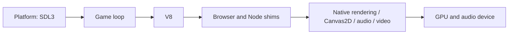

<!--
SPDX-License-Identifier: GPL-3.0-or-later
Copyright (C) 2026 The smzuggler contributors
Modified 2026-11-05: describe V8 as the only runtime engine.
Modified 2026-11-01: document the fork evaluator entry point and scenarios.
Architecture guide for contributors replacing browser and NW.js services.
Keep current Outsider behavior distinct from planned smzuggler behavior;
source references and directory coverage are checked by the tool tests.
-->

# smzuggler architecture

smzuggler is an independent, open-source RPG Maker MZ runtime based on Outsider
by General Arcade. It runs locally installed game JavaScript against native
platform, graphics and media services instead of a browser/NW.js wrapper; it
ships no game content and is not affiliated with the game or engine authors.
The runtime uses V8, SDL3, native rendering and SoLoud.
smzuggler is moving to V8 and a WebGL2-oriented compatibility stack; that target
is a plan, not a description of completed migration work. See the
[specification](docs/spec/SPEC.md) for the target API requirements.

## Overview and provenance

In the target, WebGL2 sits alongside Canvas2D, audio and video behind the shims.
Today PIXI compatibility calls native rendering rather than running the target
WebGL2 stack. The inherited implementation is in `src/engine/`, `src/bindings/`,
`src/shims/` and the native service directories below. smzuggler-specific identity
and privacy support live in `src/smzuggler/`; policy, documentation and gate tools
are fork work. Existing headers preserve Outsider ownership; a directory's
provenance does not imply every file in it is unchanged upstream code.

## Process, threads and ownership

One runtime process owns one game session. The main thread creates the SDL
window, graphics context and JS engine, evaluates scripts, polls events and
presents frames. JS values and native graphics resources stay on that thread;
callbacks into JavaScript must return there. `src/engine/js_engine_v8.cc` owns the
V8 isolate/context and explicit microtask checkpoints. `src/main.c:main` coordinates
service lifetimes and tears down graphics resources before the platform context.

SoLoud's mixer thread consumes audio independently. The streaming PCM ring in
`src/audio/audio_engine.cpp` is protected by its mutex: the main thread supplies
samples, the mixer consumes them, and shutdown stops voices before freeing
sources. Do not touch JS or graphics from the mixer. Video update/draw is called
on the main thread from `src/engine/game_loop.c:game_loop_step`; the current
video integration is not a separate JS execution thread.

Optional control mode adds a stdin reader thread in
`src/engine/game_loop.c:control_reader_thread`. It allocates command lines and
queues them under a mutex; the main loop consumes them and performs evaluation
or screenshots. It never evaluates JS on the reader thread. Shutdown detaches
that potentially blocked reader and deliberately leaves its queue alive until
process exit. This is inherited debug behavior, not a general worker model.
V8 platform workers never enter the isolate. Only the main thread owns JS
handles, following [the binding lifetime rules](docs/js-binding.md#handle-rules).

## Startup to the first frame

1. `src/main.c:main` parses the game/shim paths and debug options, initializes
   console/error reporting, and checks the game entry script before opening a
   window. Current inherited lookup also accepts a positional game path and a
   packaged game directory beside the executable, with Android-specific setup.
2. `src/platform/platform_sdl3.c:platform_init` creates the platform/window/context.
   Main adjusts default sizing for desktop scale, then
   `src/engine/js_engine_v8.cc:js_engine_init` creates V8.
3. Main registers IO, images, Canvas2D, fonts, renderer, filters, tilemap, audio,
   input, platform, effects and video bindings. Native services are initialized
   before their dependent scripts; IO receives the selected game root.
4. `src/engine/script_loader.c:script_loader_load_all` evaluates the ordered
   pre-game shims, the game's optional compression library, engine core scripts,
   plugin metadata and enabled plugins, then post-core patches and the game's
   entry script. Jobs are drained between load stages. The game files are
   external inputs, not repository references or redistributable fixtures.
5. The loader registers enabled plugin parameters/names before evaluating plugin
   bodies. It supplies the current-script identity and records loaded scripts
   for the DOM shim. Its final fallback invokes SceneManager.run with Scene_Boot
   if the game entry script has not already selected a scene, initializing the
   effects runtime first when present. Scene_Boot is supplied by the game.
6. Main initializes display information and window dimensions in JS, creates a
   60 Hz loop with `src/engine/game_loop.c:game_loop_create`, applies debug
   options, and enters `src/engine/game_loop.c:game_loop_run`. The first rAF
   dispatch lets the game's scene update/render machinery advance its boot.
   Failed shim loading takes teardown rather than entering the frame loop;
   some inherited game-script errors are logged and loading continues.

The authoritative executed load order is in the load-all function. Its separate
load-order query currently puts the post-core patch before plugins, whereas
execution puts it after plugins; do not use that query to infer startup behavior.

### Shim ordering

`src/engine/script_loader.c:script_loader_load_shims` evaluates these before any
game code, in this order:

1. `src/shims/dom_shim.js`
2. `src/shims/canvas2d_shim.js`
3. `src/shims/font_shim.js`
4. `src/shims/navigator_shim.js`
5. `src/shims/xhr_shim.js`
6. `src/shims/storage_shim.js`
7. `src/shims/pixi_shim.js`
8. `src/shims/webaudio_shim.js`
9. `src/shims/effekseer_shim.js`
10. `src/shims/dom_overlay.js`
11. `src/shims/plugin_compat.js`

`src/shims/tilemap_shim.js` patches engine classes after core and plugins.
`src/shims/control_shim.js` loads separately only when control mode is enabled,
after normal script startup and before the loop runs.

## Frame lifecycle and measurements

`src/engine/game_loop.c:game_loop_step` currently executes:

1. Cache JS callbacks on first use, dispatch queued control commands, arm the
   script watchdog, poll SDL events, propagate resize/input and update gamepads.
2. Flush timers.
3. Run V8 microtask checkpoints (promise/microtask work).
4. Flush rAF callbacks with elapsed milliseconds. Game update and native drawing
   occur through these callbacks. Drain jobs again, then advance/draw video using
   elapsed seconds since the previous frame start.
5. Update audio fades/voice cleanup; capture requested debug screenshots before
   swapping, and apply frame-limit/probe handling.
6. Present the renderer when its renderer slot is supplied, then swap platform
   buffers. Update statistics/FPS and pace to the target if VSync did not do so.

Performance counters bracket events, timers, the first jobs drain, rAF, and
present/swap. The rAF bucket includes the second jobs drain and video; the swap
bucket also includes intervening audio/debug work because its start timestamp
is the end of rAF. Total time ends after swap, excluding the final pacing delay.
The optional performance report averages these buckets over a requested number
of frames; it is not yet the full target frame-statistics system of spec §14.3.

The target lifecycle is timers → rAF → microtasks → render → present, with
explicit frame statistics. Preserve the distinction: the current implementation
has an earlier jobs drain and draws inside rAF rather than a standalone render
phase. Changing that ordering is runtime work beyond this architecture guide.

## JavaScript ↔ native seam

`src/engine/js_engine.h` exposes opaque engine evaluation and checkpoint APIs.
`src/bindings/` uses the C seam `src/jsb/jsb.h`, implemented solely by
`src/jsb/jsb_v8.cc`, to register native objects and functions. Shims translate
browser, NW.js and Node calls into native services. The engine owns the jsb
runtime; native services remain owned by main and their service modules.

All JS runs on the main thread. Call-scoped handles never escape; retained
callbacks have one owner and release their V8 Globals before isolate disposal.
See [JS binding](docs/js-binding.md) for lifetime, cache and checkpoint contracts.
Code caches live in the host cache directory, keyed by source, V8 version and
flags; evaluating a game script never writes beside it.

## Game, save and runtime directories

The game installation is an external input, potentially read-only. Current
Outsider startup checks its entry script and may place debug/console logs in the
game root; current storage compatibility also predates the target environment
and save-path rules. Those inherited behaviors are migration gaps, not the data
layout smzuggler promises.

The §5.3 target selects the game with --game, otherwise game_dir in the runtime
config, otherwise an explanatory error. It validates content rather than install
location and does not search libraries or call Steam APIs. The host reports the
real platform/environment so the game's save-location plugin selects its own
save directory. The save-folder parameter is read at runtime; this guide does
not embed game-specific names or IDs. The planned generic IO guard rejects
relative save destinations and writes inside the game root. Save imports copy,
never move, and require consent or an explicit import path; the source is never
written. Game-profile isolation is planned, not an existing source file here.

Runtime-owned data uses the binary identity smzuggler-rt, separate from the
plugin-selected game save directory:

| Base | Runtime use / target location |
| --- | --- |
| XDG_DATA_HOME | smzuggler-rt/; test save fixtures only in its fixtures/ child |
| XDG_STATE_HOME | smzuggler-rt/ for persistent runtime state/logs |
| XDG_CACHE_HOME | smzuggler-rt/ for disposable caches |
| XDG_CONFIG_HOME | smzuggler-rt/config for runtime configuration |
| Windows/macOS | SDL_GetPrefPath with empty organization and smzuggler-rt application |

Use platform defaults when XDG bases are unset. Game-save resolution follows
§5.3's Linux data base, Windows roaming application data, or macOS application
support, plus the plugin-selected directory. Runtime-directory/config migration
and save import are target requirements, not completed features of M0.

## Directory map

Every source/tool directory is listed; generated Python caches are excluded.
“Upstream” identifies inherited Outsider responsibilities; “fork” identifies
smzuggler infrastructure. Mixed directories retain upstream services and fork
changes together.

| Directory | Responsibility / provenance |
| --- | --- |
| `src/` | Runtime entry point and service composition; upstream with fork identity changes. |
| `src/audio/` | SoLoud mixing, decoding and PCM streaming; upstream. |
| `src/bindings/` | C jsb registrations bridging shims to native services; upstream. |
| `src/effects/` | Native effects backend integration; upstream. |
| `src/engine/` | Script engine, loader, frame loop and errors; upstream with fork log privacy. |
| `src/input/` | Native keyboard, mouse and controller state; upstream. |
| `src/io/` | Filesystem access and game-root resolution; upstream. |
| `src/jsb/` | C binding seam `jsb.h` and its V8 backend ([JS binding](docs/js-binding.md)); fork. |
| `src/platform/` | SDL window/events, graphics setup and OS adapters; upstream. |
| `src/rendering/` | Renderer, images, fonts, Canvas2D, filters and tilemaps; upstream. |
| `src/rendering/shaders/` | Native rendering shader sources; upstream. |
| `src/shims/` | Browser/NW.js/Node and engine compatibility JavaScript; upstream. |
| `src/smzuggler/` | Runtime identity and privacy log scrubbing; fork. |
| `src/video/` | Video decode, playback timing and drawing; upstream. |
| `src/webgl/` | Native WebGL2 context over GLES 3.0 / GL 3.3 core and its V8 fast-call bindings ([WebGL](docs/webgl.md)); fork. |
| `tools/` | Build, packaging and evaluation utilities; mixed upstream and fork. |
| `tools/commitmsg/` | Commit subject checks and fixtures; fork. |
| `tools/compat/` | Plugin require/process surface scanner; fork. |
| `tools/doclint/` | Source documentation, Markdown and docs-touched checks; fork. |
| `tools/evaluator/` | Runtime evaluation driver support; mixed: upstream NW.js/Outsider comparison plus the fork's isolated scratch-copy entry point `smzuggler.py`, which launches the host with scratch HOME/XDG directories ([local scenarios](docs/testing.md#local-title-map-menu-and-save-scenarios)). |
| `tools/evaluator/scenarios/` | Evaluation scenario definitions; mixed: upstream scenarios plus the fork's `smz-basics.json` title, Map 92, menu, save/reload and close control route. |
| `tools/forge/` | Offline worker build/test and policy gate entry points; fork. |
| `tools/format/` | Formatting and ES5 checks; fork. |
| `tools/perf/` | Offline perf call-graph attribution and bucket rules; fork. |
| `tools/privacy/` | Repository privacy scanning and tests; fork. |
| `tools/share/` | Offline run-bundle packager with privacy scrubbing; fork. |
| `tools/smoke/` | Read-only game smoke runner with scratch XDG storage; fork. |
| `tools/upstream/` | Isolated, offline upstream offer extraction; fork. |
| `tools/v8/` | Pinned V8 static-monolith build into `$SMZ_DEPS_DIR` ([V8 build](docs/build-v8.md)); fork. |

## Where do I start?

- **Plugin crash:** trace `src/engine/error_handler.c`, then
  `src/engine/script_loader.c` for evaluation order and the relevant shim in
  `src/shims/`. Reproduce against an externally supplied game directory; keep
  proprietary code and saves out of repository fixtures.
- **Add an API:** consult the [API requirements](docs/spec/SPEC.md), then
  its shim in `src/shims/`, binding in `src/bindings/` and native service in the
  map above. Add game-free tests and document deviations from the browser API.
- **Frame spike:** start with `src/engine/game_loop.c:game_loop_step` and the
  phase report; distinguish JS/rAF, jobs, video and swap costs before tracing
  `src/rendering/` or `src/audio/`. Current buckets have the limits noted above.
- **Change architecture:** update this map and the
  [decisions](docs/DECISIONS.md); follow [style guidance](docs/style.md) and
  [contributing instructions](CONTRIBUTING.md). Reference integrity is tested in
  `tests/tools/test_architecture_refs.py`.
